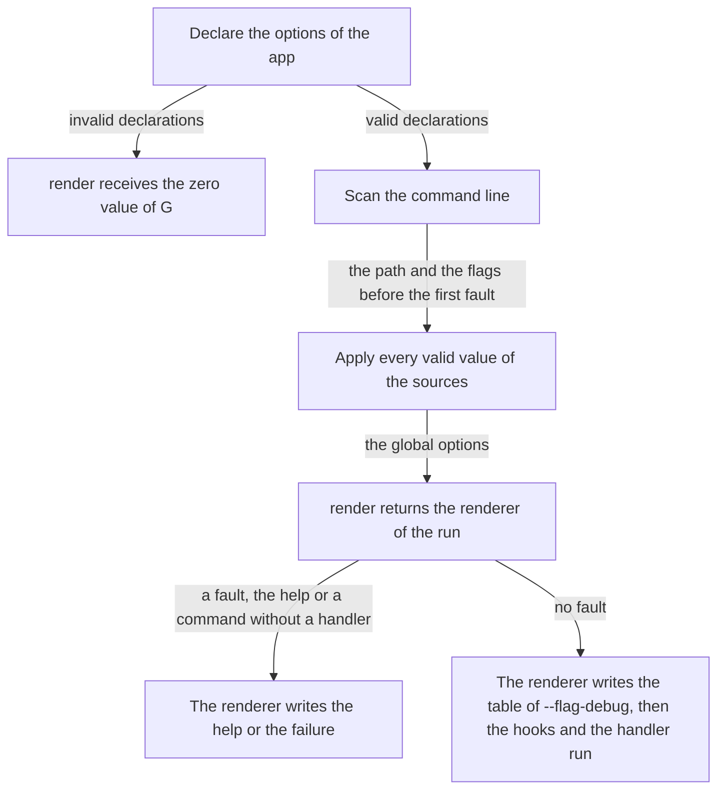

<!--
  ~ Copyright Stealth Scale B.V. 2026
  ~ SPDX-License-Identifier: MIT
-->

# RFC-0005: A renderer for each run

## Summary

`App.RenderFor` registers a function that selects the renderer of each run from the global options of the run. A program that selects its output format with an option then writes its help, its failures and the table of `--flag-debug` in that format. The resolution of the sources applies every valid value and returns the first error, so the options of a failed run contain each value that the run could read. `App.Render` keeps one renderer for every run.

## Motivation

A program that selects text or JSON with a global option `--format` needs to write each failure in that format. Under `--format=json` each failure of a run is one line of JSON on the standard output. A script that reads the stream then receives a usage error as an event.

`App.Execute` returns the error of a command line that does not scan before it applies any source (`app.go:134-135` at v0.2.0). The one renderer of the app then receives the environment of the run and a `Failure` without the options. The program of issue 3 registers a renderer that prints what its method `Error` receives:

```console
$ acme --format json run --bogus
Error receives 122 variables and {Err:cli: run: unknown flag --bogus App:acme Command:run Message:unknown flag --bogus Suggestion: Usage:true}
$ echo $?
2
```

The grammar of the package covers the long flag with `=` and with a value, the short flag, a global flag after the name of a command and the `--` that ends the flags. A program that scans its arguments for `--format` before `Execute` repeats that grammar. A program can also read the format from an environment variable alone. The example `15-renderer` reads `OUTPUT=json` this way. A flag `--format json` on the command line of such a program cannot select JSON for its usage errors.

`terraform plan` of Terraform v1.16.5 renders a flag error with its JSON view when `-json` comes before the fault. Its `ParsePlan` returns "the best effort interpretation of the arguments" together with the errors of the flags. The command builds its view from that result "even if there are flag errors, so that we render diagnostics according to the desired view". Go's `flag` package parses those flags and stops at the first error, so a `-json` after the fault does not count.

## Detailed design

### Components

| Component | Change | Responsibility |
|---|---|---|
| `App.RenderFor` | New | Registers the function that selects the renderer of each run |
| `App.Render` | Documentation | Registers one renderer for every run |
| The resolution of the sources | Changed | Applies every valid value of the sources of a run and returns the first error |
| The run behind `Execute` and `Main` | Changed | Calls `render` once and passes the renderer of the run to `Main` |

### API

```go
// RenderFor registers render as the function that selects the renderer of each run. A run calls
// render once with its global options. The renderer that render returns writes the help of the
// run, its table of --flag-debug and the failure that [App.Main] writes. A later call of RenderFor
// or [App.Render] replaces an earlier one.
//
// render runs on the goroutine of [App.Execute] or [App.Main]. Concurrent runs call it at the same
// time, so render must be safe for concurrent use. It must not keep or change the options.
//
// [App.Execute] returns an error that wraps [ErrDeclaration] when render is nil.
func (a *App[G]) RenderFor(render func(global *G) Renderer)

// Render registers r as the renderer of every run of the app. A later call of Render or
// [App.RenderFor] replaces an earlier one. An app without a call uses [Plain].
//
// [App.Execute] returns an error that wraps [ErrDeclaration] when r is nil.
func (a *App[G]) Render(r Renderer)
```

A program that selects JSON with a global option registers a function that reads the option. `jsonRenderer` is a renderer of the program like the one of the example `15-renderer`:

```go
type Global struct {
	Format string `help:"Output format." default:"text" enum:"text,json"`
}

a := cli.New[Global]("acme", "Generate code.")
a.RenderFor(func(g *Global) cli.Renderer {
	if g.Format == "json" {
		return jsonRenderer{}
	}
	return cli.Plain{}
})
```

```console
$ acme --format json run --bogus
{"app":"acme","command":"run","message":"unknown flag --bogus","usage":true}
$ ACME_FORMAT=json acme run --bogus
{"app":"acme","command":"run","message":"unknown flag --bogus","usage":true}
$ acme run --bogus --format json
acme: run: unknown flag --bogus
```

Each of the three runs exits with the status 2 that it has today.

### The run

A run of an app with `RenderFor` takes these steps:



An app with `Render` keeps the order of a run today. Its run applies the sources only when the scan succeeds, the command line has no flag of the help and the command has a handler.

### The options that render receives

`render` receives the global options of the run. The run applies its sources before it calls `render`, also when the scan fails, when the command line has a flag of the help and when the path ends at a command without a handler. It applies every valid value of each source:

- The flags count up to the first fault of the command line. An unknown flag can take a value or not, so the scanner cannot read the arguments after it.
- A value that does not convert leaves the option at the value of the earlier sources. `--format xml` leaves the default `text`.
- The run skips a config file that does not open or decode. It skips a key of the file without an option and applies the other keys.
- A missing required option or positional argument does not stop the other sources.

For invalid declarations and for an incomplete `Env`, `render` receives the zero value of G.

### The resolution of the sources

The resolution applies the defaults, the config file, the environment variables, the flags and the positional arguments in that order, as it does today. It does not stop at the first error. It applies every value that converts and returns the first error in the order of the sources. Today the resolution stops at that same error, so `App.Execute` returns the same error for every run. `assign` already leaves an option unchanged when one of its values fails, because it parses every value before it sets the field.

```go
// resolve applies every valid value of the sources of the run in the order of their precedence and
// returns the first error. A value that fails leaves its option at the value of the earlier sources.
func (a *App[G]) resolve(env *Env, d *declaration[G], in *input[G]) error

// applyConfig applies every valid key of the config file of the run and returns the first error. It
// skips the file when the file does not open or decode.
func (a *App[G]) applyConfig(env *Env, d *declaration[G], in *input[G]) error
```

### The renderer of the run

`App` keeps either the renderer of `Render` or the function of `RenderFor`. `Execute` and `Main` share one unexported function, which returns the renderer that writes the failure:

```go
type App[G any] struct {
	renderer Renderer                 // the renderer of Render, or nil after RenderFor
	render   func(global *G) Renderer // the function of RenderFor, or nil after Render
	// The other fields do not change.
}

// run runs the command line of env as Execute describes. It returns the error of the run and the
// renderer that writes the failure of the run.
func (a *App[G]) run(ctx context.Context, env *Env) (Renderer, error)
```

`Execute` returns the error of `run`. `Main` writes the failure with the renderer that `run` returns.

### Rules

- The renderer that `render` returns writes the help of the run, its table of `--flag-debug` and the failure that `App.Main` writes.
- A run calls `render` before it writes the help or the table and before the hooks run. Changes that a hook makes to the global options do not change the renderer of the run.
- `Plain` writes the output of a run whose `render` returns nil.
- `App.Execute` keeps its signature. A program that calls `Execute` and writes its failures itself does not receive the renderer of the run.

### Invariants

1. `App.Execute` returns the same error as v0.2.0 for every command line, environment and config file, and `App.Main` returns the same exit status.
2. A run calls `render` at most once.
3. The output of an app with `Render` does not change, and its runs open the same files as before.
4. The hooks and the handler run only when every source applies without an error.
5. The package imports only the standard library.

### Failure handling

| Case | Behaviour |
|---|---|
| `RenderFor(nil)` | `App.Execute` returns an error that wraps `ErrDeclaration` for every command line |
| `render` returns nil | `Plain` writes the output of the run |
| `render` panics | The package does not recover the panic. It does not recover the panic of a renderer either |
| A value of a source does not convert | The option keeps the value of the earlier sources. The run returns the first error |
| The config file does not open or decode | The run applies the environment variables and the flags, and returns the error of the file |
| The declarations are invalid | `render` receives the zero value of G. `App.Execute` returns the error that wraps `ErrDeclaration` |
| `Help` or `Debug` of the renderer of the run fails | `App.Execute` returns the error unchanged |
| `Error` of the renderer of the run fails | `App.Main` ignores the error and returns the exit status of the run |

### Cost

`testing.AllocsPerRun` measures 91 allocations for a run of `acme run` and 91 for `acme --format json run --bogus` with v0.2.0 on Go 1.27.2. In an app with `RenderFor`, a failed scan, a help and a command without a handler add one resolution of the sources. A successful run contains that resolution, so the resolution costs fewer than the 91 allocations of `acme run`. Runs whose sources apply without an error do no more work than today. The resolution of a failed run also applies the values after its first error.

### Capabilities left out

- **Flags after the first fault.** A scan that skips an unknown flag and continues would find `--format json` in `acme run --bogus --format json`. The scanner cannot know how many arguments an unknown flag takes, so it would read the arguments after the fault with a guess. cobra parses with pflag and Terraform with Go's `flag` package. Both stop at the first fault too. Users who put the format flag last set the format through the environment variable instead. A program whose users cannot set the variable would reverse this verdict.
- **The renderer for a caller of `Execute`.** `App.Execute` returns the error alone, so a program that writes its own failures reads the format from its options or from its environment. A caller of `Execute` that needs the renderer of a failed run would reverse this verdict.
- **A renderer for each command.** `render` receives the global options. A command whose own options select a format would need the options of its path. No program has asked for it.
- **The environment in `render`.** The options already contain the values of their environment variables. Each method of the renderer still receives the environment of the run.

### Changes outside the package

- The example `15-renderer` selects JSON with the global option `--format` and `RenderFor`. It no longer reads the variable `OUTPUT`, and its transcript gains a usage error in JSON.
- The README and the documentation of the package describe `RenderFor` in their sections on the output.
- The changeset of the package adds `App.RenderFor` as a minor change.

### Migration

A program does not need to change. `Render` keeps its signature and its behaviour.

### Tests

- A run with a valid format flag writes its help, its failure and its table of `--flag-debug` with the renderer that the flag selects.
- A failure of the scan selects the renderer from a flag before the fault and not from a flag after it.
- A value that does not convert leaves the option at its earlier value for `render`.
- A config file that does not open or decode gives `render` the values of the environment and the flags. A config file with an unknown key applies its other keys.
- A run with `--help` and a path that ends at a command without a handler select the renderer from their sources.
- `render` receives the zero value of G when the declarations are invalid.
- `RenderFor(nil)` makes `Execute` return `ErrDeclaration`. `Plain` writes the output of a run whose `render` returns nil.
- A later `Render` replaces `RenderFor`, and a later `RenderFor` replaces `Render`.
- A hook that changes the global options does not change the renderer of the run.
- A property over generated command lines checks invariant 1. An app with `RenderFor` returns the same error as the same app with `Render`.
- The specs of the errors of the resolution pass without a change.
- An app with `Render` does not open its config file for `--help` or after a failed scan.
- Coverage and the mutation score are 100%.

## Alternatives considered

### The options in the failure

`Failure` and `Help` could gain a field `Global any` with the options of the run.

**Why not:** a renderer would assert the type of the options. The renderer of the module charm serves every app, so it does not know the type of their options. The run would still need to apply its sources after a fault to fill the field.

### A function for usage errors

cobra v1.10.2 calls the function of `SetFlagErrorFunc(f func(*Command, error) error)` when the flags of a command fail. The function receives the command. Its flag set keeps the values that pflag set before the fault. urfave/cli v3.14.0 calls `OnUsageError` for a usage error. Its type is `func(ctx context.Context, cmd *Command, err error, isSubcommand bool) error`.

**Why not:** the function covers the usage errors alone. The help and the table of `--flag-debug` would still come from the renderer of the app. The package passes its whole output through one renderer, so a renderer for each run covers the help, the table and the failures.

### The parse context in the error

kong v1.16.1 returns a `*kong.ParseError`. Its field `Context` contains the parse of the command line. Kong applies the values to the struct of the program only after the parse succeeds.

**Why not:** the declarations of the package are unexported. A parse context in `*Error` would make them API. Each program would then read the format from the parse instead of from its options.

### A second declaration for the renderer

After a fault the run could declare its options a second time and apply the valid values of its sources to the copy.

**Why not:** the resolution would need a second set of rules that skip each error, beside the rules that stop at the first one. A failed run would also declare its options twice. A resolution that applies every valid value serves the run and the renderer with one declaration.

### A scan in the program

The program scans its arguments for the format before `Execute`.

**Why not:** the scan repeats the grammar of the package and drifts from it when the grammar changes. Every program with a format option would write the same scan.

### A generic renderer

`Renderer` could take the type of the global options as a type parameter. Its methods would then receive `*G`.

**Why not:** every renderer would then serve one type of options. `Plain` and the renderer of the module charm serve every app.

## Drawbacks

- The package gains the method `App.RenderFor`. `App` gains one field. `Execute` and `Main` share an unexported function that also returns the renderer of the run.
- A failed resolution applies the values after its first error. A conversion of `App.Convert` and the `Set` or `UnmarshalText` method of an option type run for those values, although the run fails.
- A run with `--help` of an app with `RenderFor` opens its config file. The transcript of `clitest` then shows the file for such a run.
- The flags after the first fault do not count. `acme run --bogus --format json` fails in text.

## Open questions

None.

## Unresolved and future work

- This RFC does not give a caller of `Execute` the renderer of a failed run.
- This RFC does not select a renderer from the options of a command.

## References

| What | Where |
|---|---|
| Issue 3: a renderer cannot write a usage error in the format that an option selects | <https://github.com/stealth-scale/go-cli/issues/3> |
| Terraform v1.16.5: the view of `plan` from the parsed arguments | <https://github.com/hashicorp/terraform/blob/v1.16.5/internal/command/plan.go#L33-L45> |
| Terraform v1.16.5: `ParsePlan` and its best-effort result | <https://github.com/hashicorp/terraform/blob/v1.16.5/internal/command/arguments/plan.go#L41-L103> |
| Terraform v1.16.5: the JSON view of `plan` and its diagnostics | <https://github.com/hashicorp/terraform/blob/v1.16.5/internal/command/views/plan.go#L24-L36> |
| Terraform v1.16.5: the flag set with `flag.ContinueOnError` | <https://github.com/hashicorp/terraform/blob/v1.16.5/internal/command/arguments/default.go#L13-L19> |
| Go 1.27.2: `flag.FlagSet.Parse` returns at the first error | <https://github.com/golang/go/blob/go1.27.2/src/flag/flag.go#L1153-L1177> |
| cobra v1.10.2: `SetFlagErrorFunc` | <https://github.com/spf13/cobra/blob/v1.10.2/command.go#L326-L330> |
| cobra v1.10.2: the call of the flag error function | <https://github.com/spf13/cobra/blob/v1.10.2/command.go#L919-L922> |
| pflag v1.0.9, which cobra v1.10.2 requires: the parse loop that returns at the first error | <https://github.com/spf13/pflag/blob/v1.0.9/flag.go#L1129-L1158> |
| urfave/cli v3.14.0: `OnUsageErrorFunc` | <https://github.com/urfave/cli/blob/v3.14.0/funcs.go#L33-L37> |
| urfave/cli v3.14.0: the call of `OnUsageError` | <https://github.com/urfave/cli/blob/v3.14.0/command_run.go#L197-L201> |
| kong v1.16.1: `ParseError` | <https://github.com/alecthomas/kong/blob/v1.16.1/error.go#L3-L10> |
| kong v1.16.1: `Kong.Parse` | <https://github.com/alecthomas/kong/blob/v1.16.1/kong.go#L316-L349> |
| The allocations of three runs of the program of issue 3 with v0.2.0, by `testing.AllocsPerRun` under Go 1.27.2 | Measured on 2026-10-13 |
