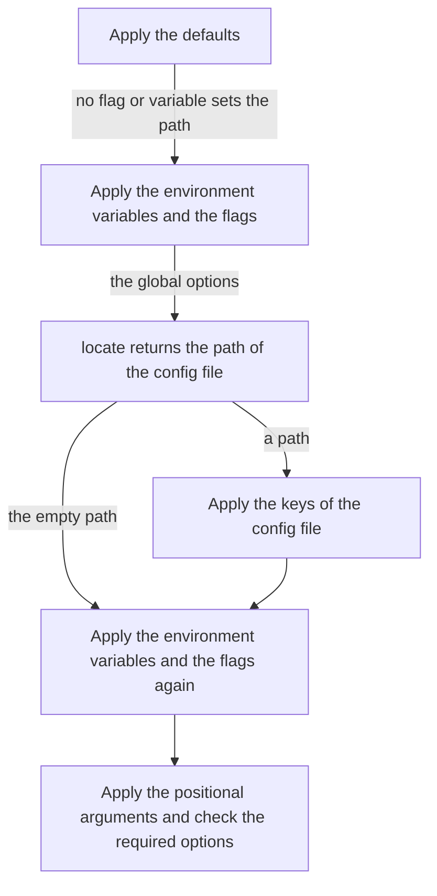

<!--
  ~ Copyright Stealth Scale B.V. 2026
  ~ SPDX-License-Identifier: MIT
-->

# RFC-0006: Ignored config keys and a located config file

## Summary

`App.IgnoreKeys` registers config keys that the app decodes itself. A config file can then contain a document of the app beside the keys of its options. `App.LocateConfig` registers a function that returns the path of the config file of a run when neither its flag nor its environment variable sets the path. An app can then search for its file, such as from a directory upward. The function receives the `Env` of the run, so a test controls the files that the search finds. `--flag-debug` shows a located path with the source `located`.

## Motivation

A program can keep one file for each workspace and decode most of the file itself. Its file `.acme.json` contains the plans of the workspace and the settings of its extensions. Their names are known only at run time, so no options struct can declare them. The same file also sets options of the command line. Its key `strict` sets the option `--strict` through the package.

A run fails for every key of the file that is not the key of an option. A program with the option `Strict` and the default path `.acme.json` shows it with v0.2.0:

```console
$ cat .acme.json
{"version": 1, "strict": true, "plans": {"api": {"enabled": false}}}
$ acme run
acme: run: unknown key plans.api.enabled in .acme.json
$ echo $?
2
```

The program searches for the file from the working directory upward and stops at the first directory with a version-control marker such as `.git`. A user runs the program in any directory of the workspace. A `ConfigFile` option takes its path from its default, its environment variable or its flag. In a subdirectory the default path does not exist. The run then skips the file:

```console
$ cd svc/store
$ acme run --flag-debug
  OPTION    VALUE         SOURCE
  --config  ".acme.json"  default
  --strict  false         default
strict=false
```

Today a program either keeps its options in a second file or does not declare a `ConfigFile`. To search, it sets the environment variable of the option before `Execute`. `--flag-debug` then reports the variable as the source of the path.

viper v1.21.0 reads one config file. Its `Viper.Sub` and `Viper.UnmarshalKey` give a program one section of the file. golangci-lint v2.14.0 searches for its config file in the directory of its first argument, in each parent directory up to the root, and then in the home directory.

## Detailed design

### Components

| Component | Change | Responsibility |
|---|---|---|
| `App.IgnoreKeys` | New | Registers config keys that the app decodes itself |
| `App.LocateConfig` | New | Registers the function that returns the path of the config file of a run |
| `Located` | New | The kind of the source of a located path |
| The declaration of the options | Changed | Checks that no ignored key overlaps the key of an option |
| The reading of the config file | Changed | Skips the ignored keys and calls the function of `LocateConfig` |

### API

```go
// IgnoreKeys registers config keys that the app decodes itself. A run skips each such key of the
// config file and every key below it, so the file can contain a document of the app beside the
// keys of its options. Dots join the names of the objects of a key, as in the tag key.
//
// [App.Execute] returns an error that wraps [ErrDeclaration] for a key with an empty name, and for
// a key that overlaps the config key of an option. Keys overlap when they are equal or when one of
// them lies inside the other.
func (a *App[G]) IgnoreKeys(keys ...string)

// LocateConfig registers locate, which returns the path of the config file of a run when neither
// the flag nor the environment variable of its ConfigFile option sets the path. global contains the
// global options after their defaults, environment variables and flags, and env is the Env of the
// run. A search that tests its candidates through env.Open reads only the files of the Env, so a
// test controls the files that it finds. With the empty path the run does not read a config file.
// A later call replaces an earlier one.
//
// locate runs on the goroutine of [App.Execute], once for each run that needs a path. Runs of the
// app can call it concurrently, so locate must be safe for concurrent use. It must not change the
// options.
//
// [App.Execute] returns an error that wraps [ErrDeclaration] when locate is nil.
func (a *App[G]) LocateConfig(locate func(global *G, env *Env) (string, error))

const (
	// Located is the path of a config file that the function of App.LocateConfig returned.
	Located Kind = 5 // located
)
```

The program of the motivation decodes its own keys and searches for its file:

```go
type Global struct {
	Config cli.ConfigFile `help:"Workspace file." default:".acme.json"`
	Chdir  string         `help:"Directory to start the search from." default:"."`
	Strict bool           `help:"Fail on a disabled plan."`
}

a := cli.New[Global]("acme", "Generate code.")
a.IgnoreKeys("version", "plans")
a.LocateConfig(locate)
```

`locate` tests the file name of the default in the directory of `--chdir` and in each parent through `env.Open`. It stops at a directory with `.git`. The handler opens the located file with `run.Open(cli.InputFile(run.Global().Config))` and decodes the keys `version` and `plans` itself:

```console
$ acme --chdir svc/store --flag-debug run
  OPTION    VALUE         SOURCE
  --chdir   "svc/store"   flag --chdir
  --config  ".acme.json"  located
  --strict  true          key strict of .acme.json
strict=true
```

### Ignored keys

- A run skips an ignored key of the config file and every key below it. Each key that is neither ignored nor the key of an option still fails with `ErrUnknownKey`, with its suggestion.
- An ignored key joins the names of its objects with dots, so `IgnoreKeys("serve.routes")` skips a section of the object of a command.
- The suggestion of an unknown key comes from the keys of the options alone.
- `IgnoreKeys` adds keys to the keys of earlier calls.

### The located path

A run of an app with `LocateConfig` takes these steps when the path of its config file is not explicit:



- `locate` runs when the path of the run has a `ConfigFile` option and neither its flag nor its environment variable sets the path. An explicit path, also an empty one, does not call `locate`.
- `locate` receives the global options after their defaults, environment variables and flags. The run applies the variables and the flags again after the file, so they keep their precedence over the file. The errors of the first pass come from the second one.
- The `ConfigFile` option takes the path that `locate` returns, with the source `Located`. A handler reads the path from the option, and `--flag-debug` shows `located`.
- With the empty path the run does not read a config file. The option then takes the empty path.
- A located path that does not exist fails with `ErrConfigFile`, as an explicit path does.
- `Execute` returns the error of `locate` unchanged, so `Main` returns `ExitFailure` for it.
- An app with `Render` does not apply its sources for the help, so its help does not call `locate`.

### Invariants

1. `IgnoreKeys` and `LocateConfig` change nothing for an app that registers neither. Its runs return the same errors, write the same output and open the same files.
2. Every key of a config file that is not ignored is the key of an option or fails with `ErrUnknownKey`.
3. The environment variables and the flags keep their precedence over a located config file.
4. A run calls `locate` at most once.
5. The package imports only the standard library.

### Failure handling

| Case | Behaviour |
|---|---|
| `IgnoreKeys` receives a key with an empty name | `App.Execute` returns an error that wraps `ErrDeclaration` |
| An ignored key overlaps the config key of an option | `App.Execute` returns an error that wraps `ErrDeclaration` |
| `LocateConfig(nil)` | `App.Execute` returns an error that wraps `ErrDeclaration` |
| `locate` returns an error | `App.Execute` returns the error unchanged, and `App.Main` returns `ExitFailure` |
| `locate` returns a path that does not exist | `App.Execute` returns an `*Error` that wraps `ErrConfigFile` |
| `locate` returns the empty path | The run reads no config file |
| `locate` panics | The package does not recover the panic, as it does not recover the panic of a handler |

### Cost

Variables and flags apply twice in a run of an app with `LocateConfig` whose path is not explicit. That pass is a part of a resolution, so it costs fewer allocations than a successful run, which takes 91 allocations for the program of issue 3. The search of `locate` costs what the program makes it cost. `IgnoreKeys` adds one comparison for each key of the file and each ignored key.

### Capabilities left out

- **A search in the package.** The rules of a search differ between programs. golangci-lint searches every parent directory and then the home directory, and the program of the motivation stops at a version-control marker. A function lets each program keep its rules. Programs that repeat one search would reverse this verdict.
- **The working directory in `Env`.** A search that starts at the working directory calls `os.Getwd`. Tests pass the start directory through an option such as `--chdir`. The verdict changes for a program whose tests need the working directory of the `Env`.
- **The decoded tree of the file for the handler.** The program decodes its own document with its own decoder and checks. `Run.Open` reads the file through the `Env` of the run, so a test controls it.
- **Ignored keys for each config file.** An app registers its formats for every config file, and its ignored keys follow the same rule.

### Changes outside the package

- The example `16-workspace` locates a workspace file from `--chdir` upward and decodes the plans of the file in its handler. A run with an unknown key in the file fails.
- The README and the documentation of the package describe both methods in their sections on config files.
- A changeset for each method adds `App.IgnoreKeys` and `App.LocateConfig` as minor changes.

### Migration

A program does not need to change. An app without the two methods reads its config file as before.

### Tests

- A run skips an ignored key and every key below it, and applies the keys of the options of the same file.
- A key that is neither ignored nor the key of an option fails with `ErrUnknownKey`, and its suggestion leaves out the ignored keys.
- An ignored key with an empty name and an ignored key that overlaps the key of an option return `ErrDeclaration`.
- `locate` receives the global options of the variables and the flags, and runs once.
- A located path sets the `ConfigFile` option with the source `Located`, and the run reads its keys.
- The variables and the flags keep their precedence over the keys of a located file.
- An explicit path does not call `locate`, also an empty one.
- With an empty located path the run does not read a file. A missing located path returns `ErrConfigFile`. The error of `locate` returns unchanged.
- `LocateConfig(nil)` returns `ErrDeclaration`, and a later call replaces an earlier one.
- Coverage and the mutation score are 100%.

## Alternatives considered

### Skip every unknown key

A run could skip each key of the file that is not the key of an option, as the configuration loaders of viper do.

**Why not:** a typo in the key of an option would then pass without an error, and the run would not suggest the key that the user meant.

### A tag on the ConfigFile field

The field could list the ignored keys, such as `ignore:"version,plans"`.

**Why not:** the compiler does not check the list of a tag. The formats of the config files are also registrations of the app.

### A section for the options

The keys of the options could be inside one object of the file, such as `cli`. The run would then skip every other key.

**Why not:** the program then needs `cli.strict` where its users write `strict`. The layout of the file belongs to the program.

### A list of candidate paths

kong v1.16.1 takes a list of paths in `Configuration(loader, paths...)`. It opens each path with `os.Open` when a program builds the parser, and loads each file that exists.

**Why not:** the candidates of a search depend on the options of the run, such as `--chdir`. A list is fixed before the run, and `os.Open` reads the files of the machine in a test.

### A function without the Env

`LocateConfig` could take `func(global *G) (string, error)`.

**Why not:** the search would then read the files of the machine through `os.Stat` or `os.Open`, also in a test. Every other file access of a run goes through the `Env`.

### The environment variable of the option

The program searches before `Execute` and sets the environment variable of its `ConfigFile` option.

**Why not:** the search then runs before the run reads `--chdir`, and `--flag-debug` reports the variable as the source of the path.

## Drawbacks

- The package gains the methods `App.IgnoreKeys` and `App.LocateConfig` and the kind `Located`. `App` gains two fields.
- `Located` does not fit the order of precedence of the other kinds. The documentation of `Kind` lists it apart.
- A run of an app with `LocateConfig` whose path is not explicit applies its environment variables and its flags twice.
- The handler reads the config file a second time to decode its ignored keys.
- The package does not check the path that `locate` returns, so a wrong search reads a wrong file without an error.

## Open questions

None.

## Unresolved and future work

- This RFC does not add the working directory to `Env`.
- This RFC does not let a run search for a config file without a function of the program.

## References

| What | Where |
|---|---|
| Issue 5: a config file cannot contain keys that the app decodes itself | <https://github.com/stealth-scale/go-cli/issues/5> |
| Issue 6: an app cannot search for its config file | <https://github.com/stealth-scale/go-cli/issues/6> |
| viper v1.21.0: `Sub` and `UnmarshalKey` | <https://github.com/spf13/viper/blob/v1.21.0/viper.go#L767-L769>, <https://github.com/spf13/viper/blob/v1.21.0/viper.go#L925-L929> |
| golangci-lint v2.14.0: the search paths of its config file | <https://github.com/golangci/golangci-lint/blob/v2.14.0/pkg/config/base_loader.go#L112-L154> |
| kong v1.16.1: `Configuration` | <https://github.com/alecthomas/kong/blob/v1.16.1/options.go#L452-L483> |
| The two console samples of the motivation, by a program built on v0.2.0 under Go 1.27.2 with JSON in place of YAML | Run on 2026-10-13 |
