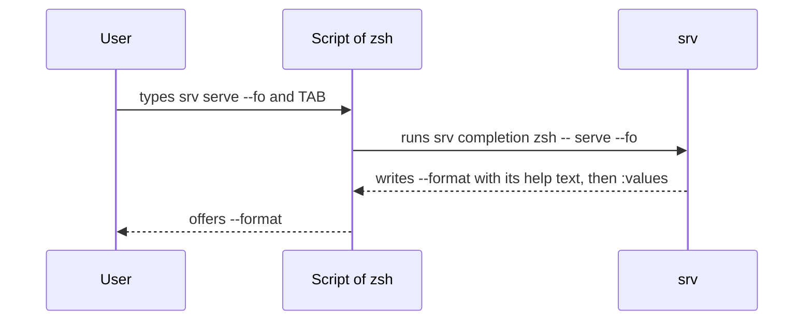

<!--
  ~ Copyright Stealth Scale B.V. 2026
  ~ SPDX-License-Identifier: MIT
-->

# RFC-0008: Shell completion for bash, zsh, fish and PowerShell

## Summary

The package adds the command `completion` to every app with commands. The command completes the app in bash, zsh, fish and PowerShell. `srv completion zsh` writes the completion script of zsh. For each TAB the script runs `srv completion zsh -- WORDS...`, and the program writes the candidates for the last word. The package derives the candidates from the declarations of the app. `App.Complete` registers a function that returns the candidates for the values of one type.

## Motivation

A user of a go-cli program types every command, flag and enum value in full. The package knows each of them from the declarations of the app, but the shell does not.

cobra v1.10.2, urfave/cli v3.14.0 and xo/ox complete the programs that they run. kong v1.16.1 has no completion. A program that moves from cobra or urfave/cli to go-cli loses completion today.

The scan applies these rules to the words before the cursor, and a shell does not know them:

- A command takes its own flags only after its name.
- A global flag can come anywhere.
- The argument `--` ends the flags.
- A bool flag does not take a separate value.
- A short flag at the end of a cluster takes the next word as its value.

The program computes the candidates itself for that reason.

## Detailed design

### Flow



### The command completion

- The package adds the command `completion` to every app whose global options do not declare a positional argument. The help of the app lists it with the text "Write the completion script of a shell.". A command of the program with the name `completion` fails the run with an error that wraps `ErrDeclaration`. A subcommand can have the name.
- The command takes the positional arguments `SHELL` and `WORDS...`. `SHELL` is one of `bash`, `zsh`, `fish` and `powershell`.
- Without `WORDS` the command writes the completion script of the shell. With `WORDS` it writes the candidates for the last word. The words before it are the words before the cursor, without the name of the program. A script passes the words after `--`, so the scan reads each of them as a positional argument.
- The command does not check the other options of the app. A required option without a value, an invalid environment variable and a config file that does not decode leave it unchanged. A missing or invalid `SHELL` fails the run with an `*Error` that wraps `ErrMissing` or `ErrInvalidValue`.
- The command does not call a hook. It applies the sources of the app only before it calls a function of `App.Complete`, so it does not open the config file otherwise.
- `App.Execute` returns nil after the command, and `App.Main` returns `ExitOK`.

### API

```go
// Candidate is a value that a completion offers for the word at the cursor.
type Candidate struct {
	Value string // the word that the shell inserts
	Text  string // the description that zsh, fish and PowerShell show, or empty
}

// Complete registers complete as the source of the candidates for a value of the type T. It applies
// to an option and to a positional argument of the type T, *T or []T. A later registration of T
// replaces an earlier one.
//
// The command completion calls complete with the global options after the valid values of their
// sources, the path of the command that the words select and prefix, the word at the cursor. It
// writes the candidates that start with prefix. The run of complete has an empty standard input
// and discards its standard output. The command returns the error of complete unchanged.
//
// [App.Execute] returns an error that wraps [ErrDeclaration] when complete is nil.
func (a *App[G]) Complete[T any](
	complete func(ctx context.Context, run *Run[G, G], prefix string) ([]Candidate, error),
)
```

A program declares a type for the values that a function completes, such as the plans of a workspace:

```go
type Plan string

type Deploy struct {
	Plan Plan `help:"Plan to deploy." arg:""`
}

a.Complete[Plan](func(ctx context.Context, run *cli.Run[Global, Global], prefix string) ([]cli.Candidate, error) {
	return planCandidates(run, run.Global().Config)
})
```

### Candidates

The command scans the words before the last one by the rules of the command line. It does not write candidates when the scan fails or when the words contain a flag of the help or of the version. Otherwise the last word, the prefix, selects the candidates:

| Prefix and words | Candidates |
|---|---|
| The prefix follows `--` | The values of the positional argument at its position |
| `--name=value` of a long flag that takes a value | The values of the option, each after `--name=` |
| Any other prefix that starts with `-` | Each flag of the path as `--name` and as `-x`, with its help text |
| The word before the prefix is a flag that takes a value | The values of its option |
| A command with subcommands | Its subcommands, with their help texts |
| Any other prefix | The values of the positional argument at its position |

- The flags include `--help`, `-h`, `--flag-debug`, and `--version` of an app with a version. A flag that the words set already is left out, unless it is a list or a map.
- The subcommands of the app include `completion`.
- A list argument takes every later position. The command does not write candidates for a position after the last positional argument.
- The command writes only the candidates that start with the prefix, also those of a function of `App.Complete`. It leaves out a candidate whose value contains a tab or a line break. A help text contributes its first line.

The command takes the values of an option from the first rule that applies:

1. The candidates of the function of `App.Complete` for its type.
2. No values for a secret option.
3. The values of an enum.
4. `true` and `false` for a bool.
5. The files with the extensions of the formats of the app for a `ConfigFile`, such as `.json`, `.ini` and `.yaml`.
6. Every file for an `InputFile`.
7. Every file for any other value of the kind string, as the shell completes it without a script.
8. No values for any other type.

### Output

The command writes one line for each candidate and then one directive line:

```text
--format	Output format.
--flag-debug	Print the value and the source of each option before the command runs.
:values
```

- A candidate line contains the value, or the value, a tab and the text. The command does not write the text for bash, because the script of bash does not show it.
- `:values` makes the shell offer the candidates alone, also when there are none.
- `:files` makes the shell offer file names. `:files json ini` limits them to directories and to the files with one of the extensions. A `:files` line is the only line of the output.

### The scripts

| Shell | Registration | Words that the script passes | Files | Descriptions |
|---|---|---|---|---|
| bash 4.1 or later | `complete -F __srv_complete srv` | The line up to the cursor, split at blanks | `compgen -f`, filtered by extension | None |
| zsh | `#compdef srv` and `compdef` | `words` up to the cursor, unquoted | `_files -g` | `_describe` |
| fish | `complete -c srv -f -a '(__srv_complete)'` | `commandline -opc` and `commandline -ct` | `__fish_complete_path` | The text after the tab |
| PowerShell | `Register-ArgumentCompleter -Native -CommandName srv` | The elements of the command before the cursor | The completion of paths of PowerShell, and `Get-ChildItem` after `--name=` | The tooltip of each `CompletionResult` |

- Each script runs the program that the user typed, with `completion`, the shell, `--` and the words.
- bash replaces only the part of the word after its last `=` or `:`, as `COMP_WORDBREAKS` defines. The script takes that part from `COMP_LINE` and removes the text before it from each candidate.
- zsh, fish and PowerShell complete the files after the `=` of a `--name=` word.
- PowerShell drops an empty argument before version 7.3 and in its mode `Legacy`. There the script passes an empty word in an escaped form, as cobra does.
- PowerShell offers its own paths when the command does not offer a candidate, as with the script of clap.

A user installs the script of a shell with one line:

| Shell | Install |
|---|---|
| bash | `source <(srv completion bash)` in `~/.bashrc` |
| zsh | `source <(srv completion zsh)` in `~/.zshrc`, after `compinit` |
| fish | `srv completion fish > ~/.config/fish/completions/srv.fish` |
| PowerShell | `srv completion powershell \| Out-String \| Invoke-Expression` in `$PROFILE` |

### Invariants

1. A command line without the command `completion` runs as before, with one exception. In an app with a handler and without commands of its own, a word that is not a flag fails as an unknown command instead of an unexpected argument.
2. The command `completion` does not call a hook or a handler. Its standard output contains the script, or the candidates and the directive line.
3. A flag or a command that the command offers scans after the words without `ErrUnknownFlag` and without `ErrUnknownCommand`.
4. The package imports only the standard library.

### Changes outside the package

- The example `17-completion` declares commands, an enum, a config file, input files and a function of `App.Complete`. Its transcript contains runs of `completion`. Its test runs each script in its shell.
- The help of each example with commands lists `completion`, so their golden files change.
- The README and the documentation of the package describe completion.
- The changesets add completion to the package as a minor change with a breaking note for the reserved name, and the examples as a patch.
- The modules charm and clitest do not change.

### Migration

A program with commands completes without a change. A program with a command named `completion` renames that command. The help of a program with commands lists one more command.

### Tests

- The specs run each row of the table of candidates and each rule of the values through `App.Execute`. The 49 completion tests of cobra call `__complete` in-process in the same way.
- A property over generated command lines checks invariant 3.
- A golden file for the script of each shell.
- The test of `17-completion` builds the example and completes words in each installed shell:
  - bash through its completion function, with `COMP_LINE` and `COMP_POINT` set.
  - zsh with stubs of `_describe`, `_files`, `compset` and `compdef`, because zsh runs its completion builtins only inside a completion widget.
  - fish through `complete -C`.
  - PowerShell through `TabExpansion2`.
- A shell that is not installed skips its case. GitHub lists PowerShell 7.6 on its images of Ubuntu 24.04, macOS 15 and Windows Server 2025, and bash 3.2 on macOS 15. So the CI jobs run PowerShell on every system and bash on Linux. zsh and fish run where they are installed.
- The same test passes with fish 4.6.0 and 3.7.0 and with PowerShell 7.4.2 in containers. bash 5.3 and zsh 5.9 also complete the lines of the test in an interactive session.
- Coverage and the mutation score of the package are 100%.

## Alternatives considered

### An environment variable

clap and Click run the program with an environment variable, such as `_SRV_COMPLETE=zsh srv`, for the script and for the candidates. clap moved its completion engine from a command to an environment variable, and the change lists "No risk for interfering with CLI parsing validation or derive logic".

**Why not:** the command is visible in the help of the program and in its completion. Its install line has the same form in every shell, while a variable needs a line of its own in PowerShell. The command also leaves the environment of the program unchanged, so a child process of a function of `App.Complete` does not inherit a request. The cost is the gap of the next alternative.

### Completion for an app whose root takes positional arguments

cobra keeps its command `completion` for a program without subcommands, but only when the command line selects it. go-cli could read the first word `completion` at the root of such an app as the command.

**Why not:** the scan would then read one word in one position differently from every other word. Such an app could not take a first argument named `completion` without `--`. Programs whose root takes positional arguments and that need completion would reverse this verdict.

### A hidden command for the candidates

cobra v1.10.2 writes its scripts with the command `completion` and its candidates with the hidden command `__complete`. xo/ox uses the same protocol, and carapace adds the hidden command `_carapace`.

**Why not:** the package has no hidden commands. One command writes both the script and the candidates, and its help lists both of its arguments.

### A command that the program can replace

cobra does not add its command `completion` when the program has a command of that name.

**Why not:** each script runs the command `completion` for every TAB. A command of the program with that name would not write the candidates, so the package refuses it.

### A hidden flag

urfave/cli v3.14.0 appends `--generate-shell-completion` to the words. The flag must be the last argument.

**Why not:** a flag after `--` is a positional argument, and the scan stops at an earlier unknown flag. urfave/cli does not write candidates after `--`.

### The line of `complete -C`

posener/complete, kongplete and argcomplete read `COMP_LINE` and `COMP_POINT` and split the line themselves.

**Why not:** `complete -C` is a feature of bash. zsh runs it through `bashcompinit` and does not show descriptions. fish and PowerShell need a script of their own in any case, and posener/complete v2.1.0 does not support descriptions.

### The scripts and the protocol of cobra

The templates of the scripts of cobra v1.10.2 for bash, zsh, fish and PowerShell have 1,143 lines. They add descriptions in bash, ActiveHelp, an order other than the order of the shell, a filter of directories and the debug file `BASH_COMP_DEBUG_FILE`.

**Why not:** the options of the package do not use these features. A copy of the scripts would also add the notice of the Apache License 2.0 to an MIT module. The package would then maintain 1,143 lines of shell.

### Functions by flag name or by tag

cobra registers a function for a flag by its name. kongplete selects a predictor by the tag `predictor:"name"`, and an unknown name fails every run of the program.

**Why not:** a name is a string that only a run checks. `App.Complete` takes a type, as `App.Convert` does, so the compiler checks it. A program that needs different candidates for two options gives them two types.

### File names from the program

clap lists the files of a directory itself and marks each directory with a trailing `/`.

**Why not:** a shell expands `~`, variables and quotes in its own completion of paths. The program receives the word unexpanded.

## Drawbacks

- The package gains the type `Candidate` and the method `App.Complete`.
- The name `completion` is reserved for the commands of an app.
- The help of every app with commands lists one more command, and its argument `WORDS` is visible there.
- An app whose root takes positional arguments does not complete.
- The scripts add 177 lines of shell, and the command 377 lines of Go with its comments.
- The scripts leave out the features of cobra that the alternatives list. bash does not show descriptions.
- The bash script needs bash 4.1 or later. macOS includes bash 3.2 in `/bin/bash`, so a user of macOS installs a newer bash or uses zsh.
- The CI jobs do not run fish, and the zsh test stubs the functions of the completion system.
- Each TAB starts the program, and the run declares the whole app first. On the machine of the build, a completion run of `17-completion` takes 1.1 to 1.2 ms from the start of the process, as long as a run of `--help`.

## Open questions

None.

## Unresolved and future work

- This proposal does not complete the entries of a map.
- This proposal has no script for elvish, nushell or other shells. Another shell needs a script and a value of `SHELL`.

## References

| What | Where |
|---|---|
| Requirement R5 and the completion of the Go libraries | [Research 0001](../research/0001-does-a-stdlib-declarative-cli-exist.md) |
| cobra v1.10.2: `__complete` and the directive line | <https://github.com/spf13/cobra/blob/v1.10.2/completions.go#L28-L35> and <https://github.com/spf13/cobra/blob/v1.10.2/completions.go#L286-L293> |
| cobra v1.10.2: the default command `completion` | <https://github.com/spf13/cobra/blob/v1.10.2/completions.go#L743-L767> |
| cobra v1.10.2: the registration of the bash script | <https://github.com/spf13/cobra/blob/v1.10.2/bash_completionsV2.go#L456-L460> |
| urfave/cli v3.14.0: `--generate-shell-completion` as the last argument | <https://github.com/urfave/cli/blob/v3.14.0/completion.go#L14> and <https://github.com/urfave/cli/blob/v3.14.0/help.go#L395-L403> |
| clap_complete 4.6.11: `CompleteEnv` behind the feature `unstable-dynamic` | <https://github.com/clap-rs/clap/blob/clap_complete-v4.6.11/clap_complete/src/lib.rs#L63-L80> |
| clap pull request 5671: an environment variable for dynamic completions | <https://github.com/clap-rs/clap/pull/5671> |
| Click 8.5.0: the variable `_{PROG}_COMPLETE` | <https://github.com/pallets/click/blob/8.5.0/src/click/core.py#L1613-L1617> |
| posener/complete v2.1.0 | <https://github.com/posener/complete/tree/v2.1.0> |
| kongplete v0.4.0 | <https://github.com/willabides/kongplete/tree/v0.4.0> |
| GitHub runner images | <https://github.com/actions/runner-images/tree/main/images> |
